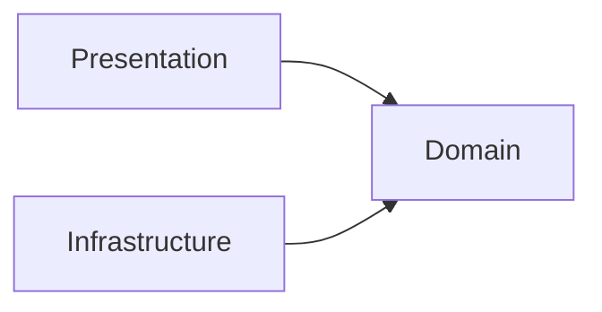

# Layered Architecture Blueprint

A layer blueprint keeps code from turning into spaghetti or becoming tightly coupled. Write one before you start coding, or while you code. It answers three questions:

1. **Where does code live?** (layers and folders)
2. **Who may talk to whom?** (dependency rules)
3. **How does data flow?** (contracts between layers)

---

## 1. Define the Layers

| Layer | Also called | Responsibility | Knows nothing about |
|---|---|---|---|
| **Presentation** | UI, Interface, Delivery | Handles input (HTTP, CLI, UI events). Shows output. Turns user intent into calls to the application. | Databases, SQL, external APIs |
| **Application / Domain** | Business logic, Service, Core | Rules, calculations, workflows, use cases | HTTP, UI frameworks, databases, file systems |
| **Infrastructure** | Data, Persistence, Adapters | Databases, external APIs, files, messaging. Turns raw data into domain models. | Controllers, views, UI state |

The core layer must work the same way whether it's called from a web app, a mobile app, a CLI, or a test.

---

## 2. The Dependency Rule

> **Source-code dependencies point inward, toward the domain. Inner layers never import outer layers.**

```text
   ┌─────────────────────────────────────────┐
   │  Presentation        Infrastructure     │   ← outer layers
   │        │                    │           │
   │        └──────►  Domain  ◄──┘           │   ← core
   └─────────────────────────────────────────┘
```

- Presentation → Domain ✅
- Infrastructure → Domain ✅ (it *implements* the domain's interfaces)
- Domain → Presentation ❌ (e.g. no HTTP status codes or React components in services)
- Domain → Infrastructure ❌ (e.g. no ORM or SQL imports in services)
- Infrastructure → Presentation ❌

**Runtime flow and dependency direction are different things.** At runtime a call goes UI → Service → Database. In the source code, the service depends only on an interface, and the database code depends on that same interface. This is the **Dependency Inversion Principle**.

---

## 3. Define the Contracts Between Layers

Layers talk through explicit boundaries. They don't pass raw database models or framework objects around.

- **DTOs (Data Transfer Objects):** plain data structures that cross layer boundaries. Keep them free of behavior and of framework types.
- **Ports (interfaces):** the domain declares what it needs, for example `UserRepository`, and the infrastructure provides the implementation, for example `PostgresUserRepository`.
- **Composition root:** one place, usually `main` or the app bootstrap, wires the concrete implementations into the domain. It is the only place that knows about every layer.

```text
domain/ports/user_repository        ← interface, owned by the domain
infrastructure/db/postgres_user_repo ← implements it
main / bootstrap                     ← injects PostgresUserRepo into UserService
```

Payoff: you can test business logic with in-memory fakes, and you can swap the database without touching the domain.

---

## 4. Document the Blueprint

Keep the blueprint in the repo, in an `ARCHITECTURE.md` file or a section of `README.md`. It should cover:

**Directory structure**

```text
src/
├── presentation/     # controllers, CLI commands, UI components
├── domain/           # entities, services/use cases, ports (interfaces), DTOs
└── infrastructure/   # repository implementations, API clients, file storage
```

**Import rules**

| From \ To | presentation | domain | infrastructure |
|---|---|---|---|
| **presentation** | ✅ | ✅ | ❌ |
| **domain** | ❌ | ✅ | ❌ |
| **infrastructure** | ❌ | ✅ | ✅ |

**Diagram:** use a text-based format such as Mermaid so the diagram is versioned with the code:



---

## 5. Enforce It Automatically

A rule nobody checks gets broken eventually. Add architecture checks to CI so that a forbidden import fails the build.

| Ecosystem | Tool |
|---|---|
| JavaScript / TypeScript | `dependency-cruiser`, `eslint-plugin-boundaries` |
| Java | `ArchUnit` |
| C# / .NET | `ArchUnitNET`, `NetArchTest` |
| Python | `import-linter` |
| Go | `go-arch-lint` |

---

## Quick Checklist

- [ ] Each layer has one clear responsibility
- [ ] The domain imports no framework, DB, or HTTP code
- [ ] The domain owns its interfaces, and infrastructure implements them
- [ ] DTOs, not ORM entities, cross layer boundaries
- [ ] Wiring happens in a single composition root
- [ ] Folder layout and import rules are documented in the repo
- [ ] CI fails when an import breaks the rules
